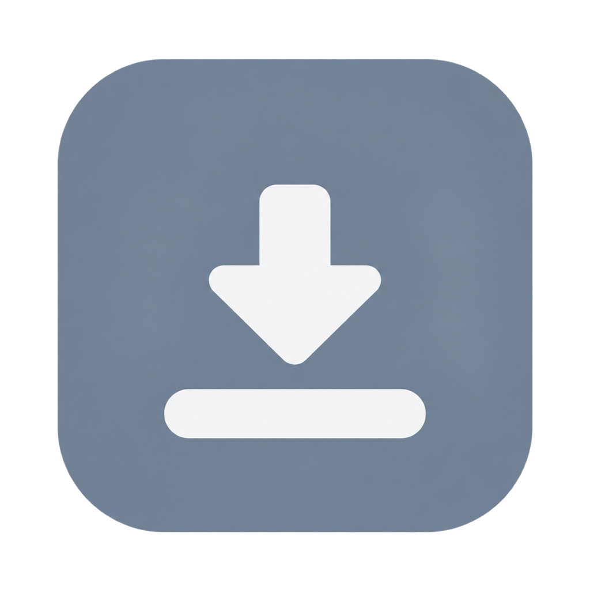

# DockClickMin



> 点 Dock 图标 = 收起前台应用（Windows 任务栏语义），macOS 原生实现。
> Click a Dock icon to collapse the frontmost app — pure Cocoa / Accessibility / CGEventTap, no third-party dependency.

菜单栏常驻，无 Dock 图标。点一下收起（genie 动画飞进图标），再点一下还原。

---

## 为什么必须自己写

macOS **没有**这个开关。点 Dock 图标只有两个语义：把 app 激活到前台；已在前台则什么都不做。系统设置里唯一相关的是 `minimize-to-application`（窗口最小化后飞进图标），那是「窗口去哪」，不是「点图标收起」。

纯 app 内的 `applicationShouldHandleReopen(_:hasVisibleWindows:)` 也不行 —— **app 已在前台时 Dock 根本不发 `rapp` 事件**，回调不会被调用。所以只能从系统层监听点击。

## 原理

```
Dock 进程 AX 树 ──► 每个应用图标的实时矩形 + bundle id
                          │
CGEventTap(左键 down/up) ─┴─► 按下：记住当时的前台 pid
                              抬起：落点仍在同一图标内 && 该 app 就是当时的前台
                                    └─► 收起它
```

三个关键设计：

1. **listen-only 事件监听**：`CGEvent.tapCreate(options: .listenOnly)`，只读不拦截，物理上无法改写或吞掉你的输入。原生行为（含 ⌥-click 隐藏其他）全部保留。
2. **命中判定用 Dock 的 AX 树**，不是硬编码坐标。放大动画、图标增减、换位置都自动跟随。
3. **1 秒刷新的矩形缓存**做廉价过滤，命中后才做精确 AX 查询，避免每次点击都付 IPC 成本。

## 安装

### 方式一：下载 DMG

从 [Releases](../../releases) 下载 `DockClickMin-<version>.dmg`，打开后把 `DockClickMin.app` 拖到旁边的 `Applications` 快捷方式。

DMG 里还有一份 `使用说明.html`（不含下载链接，适合随包分发）：双击即可看安装、菜单、常见问题。

首次打开会被 Gatekeeper 拦（ad-hoc 签名）：

> 双击被拦 → 点「完成」→ **系统设置 › 隐私与安全性 › 安全性** → 点「仍要打开」→ 输密码 → 再点「打开」

> macOS 15 Sequoia 起「右键 → 打开」这条绕过通道已被 Apple 移除，弹窗里不会再有「打开」按钮。

### 方式二：自己编译

```bash
git clone https://github.com/GeekAudio/DockClickMin.git
cd DockClickMin
./build.sh            # 编译 + ad-hoc 签名
./install.sh          # 拷到 /Applications 并启动（已存在则加 --force）
```

需要 Xcode Command Line Tools（`xcode-select --install`）。产物是通用二进制（x86_64 + arm64）。

> 建议装到 `/Applications`：工作区里的那份是开发副本，`./build.sh` 每次都会覆盖它；装到 `/Applications` 后开机自启、Finder 里双击、辅助功能列表里的条目都指向同一个位置。

### 授权（两种方式都要做）

首次启动会弹「DockClickMin 想要控制这台电脑」，点 **打开系统设置** →
**隐私与安全性 › 辅助功能** → 打开 DockClickMin 的开关。

授权后菜单栏出现 `dock.rectangle` 图标，菜单里状态显示「监听中 · N 个图标」。

> 授权生效后**不需要手动重启**：程序每 2 秒复查一次权限，一旦通过就自动建立监听（`AXIsProcessTrusted` 的结果会被进程缓存，早期版本必须重启进程才认）。

## 菜单

| 项 | 作用 |
|---|---|
| 启用 | 总开关，关掉后事件监听停止 |
| 开机自启 | 登录时自动启动，**默认开**（详见下文） |
| 唤出时提到最前 | 点 Dock 图标唤出应用后，用 `AXRaise` 把它的主窗口提到最前，**默认开** |
| 取消 QQ 置顶 | 用 QQ 自己的「置顶」菜单项把它关掉（`CGSSetWindowLevel` 会被 QQ 覆盖回去），**默认关** |
| 收起方式：最小化窗口（原生动画） | 按窗口黄色按钮 / ⌘M，genie 动画（**默认**） |
| 收起方式：隐藏整个应用（瞬时，无动画） | `NSRunningApplication.hide()`，像 ⌘H |
| 状态：监听中 · N 个图标 | 实时确认 AX 枚举是否正常 |
| 打开日志 | `~/Library/Logs/DockClickMin.log` |
| 退出 | 终止 |

## 收起方式

| 方式 | 实现 | 动画 |
|---|---|---|
| **最小化窗口**（默认） | 三级回退，每级都验证结果 | ✅ 前两级有 |
| 隐藏整个应用 | 四级回退，全失败降级为最小化 | ❌ 瞬时 |

**为什么隐藏也要回退**：实测 `NSRunningApplication.hide()` 对 TCC Helper（helper）、WorkBuddy（Electron）、Clash Verge（Tauri）**都返回 `false`**。于是按 app 类型踩出两条经验：

| 现象 | 原因 | 对策 |
|---|---|---|
| 设置 `AXHidden` 后「闪一下」 | Electron 类被置位后会自己弹回来 | AXHidden 挪到最后 |
| `postToPid` 发 ⌘H 无效 | Tauri 类不认直接投递的键事件 | 先发**全局** ⌘H（走正常键盘事件流） |

最终顺序：`hide()` → 全局 ⌘H → ⌘H→pid → `AXHidden` → 降级最小化。日志逐级记录，例如
`收起 Clash Verge：hide()=false / 全局⌘H 成功`。

三级回退（`minimizeAll`）：

| 级 | 动作 | 说明 |
|---|---|---|
| ① | 按窗口自己的 `AXMinimizeButton` | 与手点黄色按钮等价，genie 动画 |
| ② | `CGEvent.postToPid` 发 ⌘M | 走 app 自己的「窗口 › 最小化」菜单命令，也有动画 |
| ③ | 直接置 `AXMinimized = true` | 最后兜底，无动画 |

**为什么需要三级**：AX 的 `.success` 只代表「消息投递成功」，不代表 app 照做。实测 **QQ 对 ① 返回 success 但窗口不动**。只写 ① 的话这类 app 点了没反应。日志会打印每级的实际效果：

```
收起 QQ：按钮 1 成功→0/1 / ⌘M 1 次→1/1 / 起始 0/1
```

最小化动画样式跟随系统设置 › 桌面与程序坞 ›「最小化窗口使用」：

```bash
defaults read com.apple.dock mineffect          # genie | scale
defaults write com.apple.dock mineffect -string genie && killall Dock
```

## 点第二下会恢复

窗口已全部最小化时，本工具**主动放行**（`stats.minimized == stats.total` 直接 return），于是系统原生的「点图标恢复所有窗口」照常工作。所以效果是：**点一下收起（带动画），再点一下还原（也带动画）** —— 正好是 Windows 任务栏的切换语义，还原那半是系统原生行为，零额外代码。

## 启动台（Apps / Launchpad）

macOS 26 Tahoe 把启动台换成了 `/System/Applications/Apps.app`（`com.apple.apps.launcher`，`LSUIElement`）。它不是普通 app —— 没有「最小化」语义，点图标应当是**关闭**它。

所以这一格走单独分支：识别到启动台图标时，按顺序发 **Esc** → `hide()` → `terminate()`，直到进程真的退出。日志会记 `关闭 启动台：terminated=true`。

注意：`open -b com.apple.apps.launcher` **打不开它**（只能由 Dock 图标唤起），所以这一条只能靠真实点击验证。

## 边界与已知行为

| 场景 | 行为 | 原因 |
|---|---|---|
| 点**非**前台的 Dock 图标 | 正常切换，不收起 | 按下时的前台 pid ≠ 图标 pid |
| 窗口已全部最小化时点图标 | **原生恢复所有窗口** | 主动放行，不抢系统行为 |
| 点**启动台**图标且它正开着 | 关闭它（Esc → hide → terminate） | 启动器没有最小化语义 |
| 按住 ⌘/⌥/⌃/⇧ 点 | 完全放行 | 保留 ⌥-click 隐藏其他等原生操作 |
| 图标内按下后拖拽（≥8pt） | 不触发 | 防止拖拽排序图标时误收起 |
| app 一个窗口都没有 | 放行，走原生「打开新窗口」 | 否则会把「重新打开窗口」吃掉 |
| 有对话框/无标题窗口 | 那类窗口没有黄色按钮，退回置 `AXMinimized`（无动画） | AX 限制 |
| Dock 自动隐藏 | 鼠标探出后约 1 秒内可能不响应 | 矩形缓存 1s 刷新，Dock 未升起时图标坐标在屏幕外 |
| 多显示器 | 支持 | 全程用全局屏幕坐标，不做屏幕假设 |
| 唤出时提到最前 | 对普通应用有效，**压不过别的应用设置的浮动层级窗口** | `AXRaise` 只能越过同层级窗口；QQ 的置顶面板在 layer 3 |

> 关于「QQ 一直置顶，别的程序盖不住」：这是 QQ 自己把窗口设成了浮动层级（CGWindow `layer=3`，正常窗口是 0），本工具从不修改窗口层级。在 QQ 里取消置顶即可（主面板标题栏的图钉 / 菜单里的「置顶」）。

## 重编译会掉授权

ad-hoc 签名没有稳定身份，TCC 记录的是 **cdhash**。每次 `./build.sh` 后 cdhash 变化，旧授权立即失效。实测证据：

```bash
sqlite3 "/Library/Application Support/com.apple.TCC/TCC.db" \
  "select hex(csreq) from access where client='com.geekaudio.DockClickMin' \
   and service='kTCCServiceAccessibility';" | xxd -r -p > /tmp/c.bin
csreq -r /tmp/c.bin -t
#   cdhash H"83b7776a..." or cdhash H"c166ca8a..."   ← 旧二进制
codesign -d --verbose=4 DockClickMin.app 2>&1 | grep ^CDHash
#   CDHash=078f2ebd...                               ← 新二进制，不在列表里 ⇒ 拒绝
```

改完代码后：

```bash
./regrant.sh     # 重置授权 + 启动，然后在系统设置里把开关关掉再打开
```

想彻底免掉这一步，用自签名证书签名（designated requirement 与 cdhash 解耦）。

## 诊断

```bash
# 直接跑二进制拿不到授权（TCC 把调用方认成父进程），必须走 LaunchServices
open -n ./DockClickMin.app --args --diagnose      # 结果写日志

# 窗口结构 dump：逐个 app 打印 title/role/subrole/min/frame/有无最小化按钮
touch ~/Library/Logs/DockClickMin.dump && open ./DockClickMin.app

# 自测：走完整判定链（onDown → onUp → 收起），不需要真的点鼠标
touch ~/Library/Logs/DockClickMin.selftest && open ./DockClickMin.app

tail -30 ~/Library/Logs/DockClickMin.log
```

## 开机自启（内置，默认开启）

菜单栏 → **开机自启**，默认勾选。实现是写一个 LaunchAgent，登录时 launchd 自动加载，不需要 root，也不要求 app 装在 `/Applications`：

```
~/Library/LaunchAgents/com.geekaudio.DockClickMin.plist
```

每次启动都会按当前可执行文件路径重写这个 plist —— app 被移动、改名后能自愈，不会留下失效的路径。

- 取消勾选 ⇒ `launchctl bootout` + 删除 plist
- 单实例保护：launchd 与手动 `open` 同时拉起时只保留一个进程

手动检查：

```bash
plutil -p ~/Library/LaunchAgents/com.geekaudio.DockClickMin.plist
launchctl list | grep DockClickMin
```

## 卸载

```bash
launchctl bootout gui/$(id -u)/com.geekaudio.DockClickMin 2>/dev/null
rm -f ~/Library/LaunchAgents/com.geekaudio.DockClickMin.plist
rm -rf /Applications/DockClickMin.app ~/Library/Logs/DockClickMin.log
defaults delete com.geekaudio.DockClickMin 2>/dev/null
```

## 只给自己的 app 加这个功能？

不需要本工具，但**只在「app 不在前台时点图标」生效**：

```swift
func applicationShouldHandleReopen(_ sender: NSApplication, hasVisibleWindows flag: Bool) -> Bool {
    guard flag else { return true }
    for w in NSApp.windows where w.isVisible && !w.isMiniaturized && w.canBecomeMain {
        w.miniaturize(nil)      // 或 NSApp.hide(nil) 整个 app 收起
    }
    return false
}
```

要「已在前台也能收起」，就必须像本工具一样上 CGEventTap + AX，代价是辅助功能授权 + 常驻进程。

## 实测环境

macOS 26.7.1（25G241）/ Intel i7-12700K / 双屏。理论支持 macOS 13+，未在 Apple Silicon 上验证（代码是通用二进制，arm64 切片可运行）。

## License

MIT
